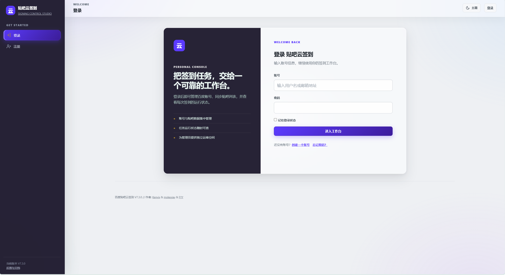
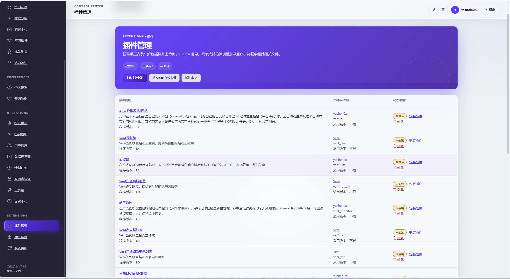
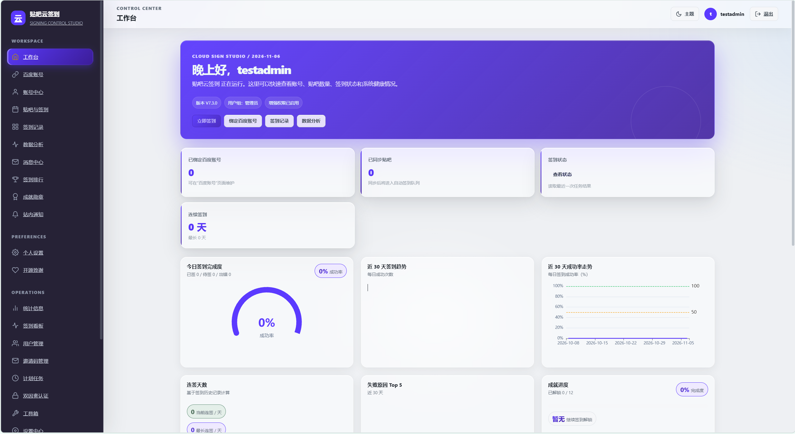

<div align="center">



# 贴吧云签到 · Signing Control Studio

**把「每天打开贴吧逐个签到」这件事，交给一台你自己掌控的服务器。**

[](https://www.php.net/)
[](https://mariadb.org/)
[](https://www.docker.com/)
[](https://github.com/yuchen0x1/baidu-tieba-yunqiandao/releases/latest)
[](license.html)

[下载 Web 部署包](https://github.com/yuchen0x1/baidu-tieba-yunqiandao/releases/latest) · [快速开始](#-快速开始) · [在线更新](#-在线更新) · [开放 API](#-开放-api) · [问题反馈](https://github.com/yuchen0x1/baidu-tieba-yunqiandao/issues)

</div>

---

贴吧云签到是一个可自托管的百度贴吧自动签到站点：登录后台绑定百度账号并刷新关注贴吧后，系统按计划任务自动完成签到、对失败项智能复签、定期检查账号凭据健康度，并把每一批结果写入日志与统计——从此告别漏签和忘签。深色侧栏 + 双主题的现代控制台界面，所有操作都在浏览器里完成，无需 SSH 也能一键升级。

本项目只维护网页版，不提供桌面客户端、Android/iOS App 或单独的 Windows 版本。检查与分发收敛记录见[仅维护网页版](docs/WEB_ONLY.md)。

- **技术栈**：PHP 8.2 及以上（推荐 8.4）· MySQL/MariaDB · Docker Compose V2
- **部署形态**：仅网页版；Docker Compose / 传统 PHP 环境
- **授权协议**：AGPL-3.0
- **交流**：QQ 群 `1016190748` · Telegram <https://t.me/lenmoC>

## 最新更新

### V7.7.0 · 2026-11-13

- 统一提供通用 Web 部署包，取消单独的 Windows 分发与启动器。
- 补齐历史版本说明，按可核实记录区分发布日期与开发批次；部署包只保留网页运行及升级所需文件。
- 推送失败或渠道未启用时，不再误报已发送；失败提醒、日报和周报保留下一轮重试机会。
- 帖子监控摘要只确认本次接受的记录，超过 30 条的后续批次继续保留。
- 个人设置显示最近推送结果和时间，手机端表单改为纵向排布，兼容深色模式。
- 通知测试使用页面表单提交；机器人回调地址加强公开地址校验，错误提示不回显响应体和密钥。

[完整更新历史](docs/releases/release-notes.md) · [本版更新与升级说明](release-notes/v7.7.0.md)

## ✨ 功能特性

### 自动签到引擎
- 计划任务 / 常驻循环（`do.php --loop`）双调度模式，复用同一套防重入锁与失败退避机制。
- 四种签到方式可组合：客户端签到、一键签到、手机网页签到、网页签到；支持客户端指纹轮换。
- 失败智能复签：按错误码白名单指数退避重试，连续失败自动通知，不轰炸渠道。
- 任务运维：按名称/描述搜索，筛选启用、禁用、失败、运行中与到期状态；运行历史支持任务名、结果、时间区间查询与分页。手机端纵向展示任务与操作。

### 工作台与数据
- 一屏总览：绑定账号、已同步贴吧、签到状态、今日完成度、近 30 天趋势与成功率、失败原因 Top 5、成就进度。
- 签到成长指标：记录每次签到获得的经验、今日排名与贴吧等级；"经验未知"不再伪装成固定值。
- 签到记录、日历、数据分析、排行榜、成就勋章、站内通知一应俱全。
- BDUSS/STOKEN 健康检查：凭据失效自动检测、可选自动停用并推送提醒。

### 多账号与安全
- 多用户 + 多百度账号 + 分组管理，账号级代理（HTTP/SOCKS5）与统一代理批量下发。
- 敏感凭据（BDUSS/STOKEN）AES-256-GCM 加密落库；CSRF、2FA、登录审计、邀请码注册一应俱全。

### 扩展生态
- 通知渠道：Server 酱、Telegram Bot、通用 Webhook、Bark、PushPlus、邮件；每日签到日报优先走个人渠道，未送达回退邮箱。
- 推送结果：个人设置查看失败提醒、每日摘要、每周报告的最近结果。服务接受才更新已发送标记；未启用、未选渠道和失败分别处理。失败项在相关任务下一次执行时重试（需任务与个人订阅已启用）。服务接受不等于终端收件或阅读。
- 开放 API：`api.php` 提供 Bearer Token 认证的状态/签到/日志/日历/排行等 17 个接口，权限矩阵自动生成文档。
- 插件体系：内置 AI 发帖/回帖、灌水、点赞、封禁、删帖、审查、帖子监控、QQ 推送、云回帖等 16 个插件，支持在线安装。

<div align="center">



*插件管理：统一安装、启用与卸载*

</div>

## 🚀 快速开始

### 方式一：Docker Compose（推荐）

```bash
git clone https://github.com/yuchen0x1/baidu-tieba-yunqiandao.git
cd baidu-tieba-yunqiandao/docker
cp .env.example .env          # 编辑 .env，至少修改 DB_PASSWD
cd ..
docker compose -f docker/docker-compose.yml up -d --build
```

访问 <http://127.0.0.1:8080>，按安装向导导入数据库并创建管理员即可。Compose 默认参数：

| 配置项 | 默认值 |
| --- | --- |
| 数据库主机 / 用户 / 密码 | `db` / `root` / `.env` 中的 `DB_PASSWD` |
| 数据库名 / 表前缀 | `tiebacloud` / `tc_` |
| Web 端口 | `8080` |

### 方式二：传统 PHP 环境

PHP `>= 8.2`（扩展 `curl`、`json`、`mysqli`，按需 `gd`、`mbstring`、`openssl`、`session`、`zip`）+ MySQL/MariaDB + 任意 Web 服务器：

1. 部署 Web 包到站点目录（需要安装依赖时使用 `composer install --no-dev --optimize-autoloader`）。
2. 访问 `/setup/install.php`，按向导完成安装。
3. 确认 `setup/install.lock` 存在，然后进入后台配置站点地址、计划任务密码与通知渠道。

<div align="center">



*工作台：账号、贴吧、签到状态与趋势一屏总览*

</div>

## ⏰ 计划任务

`do.php` 执行到期的系统计划任务，建议每分钟触发一次，由应用内部判断是否到点：

| 调用方式 | 写法 |
| --- | --- |
| Web | `https://你的域名/do.php?pw=你的计划任务密码` |
| CLI | `php /var/www/do.php --pw=你的计划任务密码` |

```cron
* * * * * php /var/www/do.php --pw='your-password' >/dev/null 2>&1
```

无 crond 的环境（如 Windows）可用常驻循环替代，与 cron 共享同一套调度与退避机制：

```bash
php /var/www/do.php --pw=你的密码 --loop        # 默认每 30 秒调度一轮
php /var/www/do.php --pw=你的密码 --loop=60     # 自定义间隔（秒，上限 600）
```

后台「计划任务」可为每项任务设置最大重试次数（0–20，0 表示不自动重试）。失败等待时间为 `cron_retry_backoff × 2^(重试序号−1)`，单次最多一天；耗尽重试后恢复正常周期。一次性任务保留执行后删除的既有语义。

「运行到期任务」遵守启用与到期状态；单项「运行」或「重试」是管理员主动操作，可执行未到期/已禁用的任务，但仍需取得运行锁。运行锁依赖 `cron_lock_timeout`：应大于任务的实际最长耗时，超时接管不保证外部副作用只发生一次。

计划任务管理写操作使用管理员会话、POST 和 CSRF 令牌；旧的 `setting.php?mod=admin:cron&run=...` 等 GET 写链接需改用页面表单。`do.php` 与开放 API 的既有入口保留。

可选的优雅重载（默认关闭）：部署方设置环境变量 `LOOP_RELOAD_FILE` 指向本地可写文件后，升级完成会通知常驻进程在本轮调度结束后退出（退出码 75），交给 s6/systemd/任务计划等进程管理器自动拉起加载新代码。

## 🔄 在线更新

管理员在后台「系统更新」页一键检查并升级：

- 通过 GitHub 正式 Release 检查新版本；GitHub API 匿名限流（403/429）时自动回退官方 Release 页面发现版本，普通服务器无需任何 Token 也能完成检查。
- 「立即更新」全自动：下载 Release 部署包 → 强制 SHA-256 校验（无可信摘要绝不覆盖）→ 保护站点配置文件 → 自动备份数据库 → 运行迁移器 → 清理 opcache → 自动返回首页。
- 更新不会覆盖 `config.php`、`key.php`、`.env`、`docker/.env` 与 `setup/install.lock`，也不改动数据库内容。
- 网络受限环境可选设置只读 `UPDATE_GITHUB_TOKEN`（仅发送给 `api.github.com`，不落盘、不随资产下载发送）。

项目源码与通用 Web 部署包发布在 [GitHub Releases](https://github.com/yuchen0x1/baidu-tieba-yunqiandao/releases)；发布流程细节见 [`docs/RELEASE.md`](docs/RELEASE.md)。
自动更新的架构、签名配置、回滚边界和故障处理见 [`docs/AUTO_UPDATE.md`](docs/AUTO_UPDATE.md)。

## ⚙️ 配置参考

### 数据库连接（环境变量）

| 变量 | 默认值 | 说明 |
| --- | --- | --- |
| `DB_HOST` | `127.0.0.1`（Compose 为 `db`） | 数据库主机 |
| `DB_USER` / `DB_PASSWD` | `root` / 空 | 数据库凭据；Compose 中密码必填 |
| `DB_NAME` / `DB_PREFIX` | `tiebacloud` / `tc_` | 数据库名与表前缀 |
| `DB_SSL` | `0` | 设为 `1` 启用 MySQL SSL 连接 |

### 安全与运行

| 变量 | 默认值 | 说明 |
| --- | --- | --- |
| `ANTI_CSRF`（别名 `CSRF`） | `true` | CSRF 防御开关 |
| `SYSTEM_SALT` | 空 | 加密与 CSRF 密钥材料；生产建议设置强随机值 |
| `WEB_PORT` | `8080` | Compose 对外 Web 端口 |
| `PUID` / `PGID` | `1000` | 容器运行用户 |
| `TC_AUTO_CREATE_INSTALL_LOCK` | `false` | 容器启动时自动创建安装锁（首次安装保持 false） |
| `SSL_CERT_FILE` / `CURL_CA_BUNDLE` | 空 | Windows PHP 指向可信 CA bundle，勿关闭证书校验 |
| `UPDATE_GITHUB_TOKEN` | 空 | 可选只读 Token，仅发送给 `api.github.com` |
| `UPDATE_RELEASE_PUBLIC_KEY` | 空 | 可选 PEM 公钥；配置后校验 Release 的 detached `.sig` |
| `UPDATE_REQUIRE_SIGNATURE` | `false` | 设为 `true` 后没有签名或签名失败会拒绝安装 |
| `LOOP_RELOAD_FILE` | 空（关闭） | `do.php --loop` 优雅重载标记文件路径 |

### 后台配置项（数据库选项）

`system_url` 站点地址、`cron_pw` 计划任务密码、`api_token` 开放 API Token、通知开关与各渠道凭据、SMTP 邮件配置等均在 Web 后台维护。

## 🔌 开放 API

后台设置中心配置 `api_token` 后，请求头携带 `Authorization: Bearer <api-token>` 调用 `/api.php`；所有响应携带 `api_version`，权限矩阵与文档（`action=openapi`）由同一份定义驱动：

| 接口 | 方法 | 访问 | 用途 |
| --- | --- | --- | --- |
| `/api.php?action=status` | `GET` | 任意 | 签到状态汇总 |
| `/api.php?action=health` | `GET` | 任意 | 百度账号健康状态 |
| `/api.php?action=sign` | `POST` | 任意 | 立即执行全部签到 |
| `/api.php?action=retry` | `POST` | 任意 | 执行失败复签 |
| `/api.php?action=health_check` | `POST` | 仅全局 | 执行账号健康检查 |
| `/api.php?action=logs&limit=50` | `GET` | 任意 | 最近日志（limit 1–200） |
| `/api.php?action=calendar&days=90` | `GET` | 任意 | 个人签到日历 |
| `/api.php?action=streak` | `GET` | 任意 | 连续签到统计 |
| `/api.php?action=ranking&limit=20` | `GET` | 任意 | 用户签到排行榜 |
| `/api.php?action=failures&limit=10` | `GET` | 任意 | 失败原因分布 |
| `/api.php?action=trend&days=30` | `GET` | 任意 | 签到趋势（每日成功/失败） |
| `/api.php?action=tieba_health&days=30` | `GET` | 任意 | 每个贴吧的健康度统计 |
| `/api.php?action=export` | `GET` | 任意 | 导出签到日志 CSV |
| `/api.php?action=monitor&limit=20` | `GET` | 仅个人 | 帖子监控命中记录 |
| `/api.php?action=update` | `GET` | 仅全局 | GitHub 最新 Release 与更新判断 |
| `/api.php?action=webhook_test` | `GET` | 仅全局 | 测试 Webhook 推送 |
| `/api.php?action=openapi` | `GET` | 任意 | 接口文档（由权限矩阵自动生成） |

「任意」= 全局 Token 与用户 Token（仅本人数据）皆可。方法不符返回 405（`method_not_allowed`），权限不符返回 403（`forbidden_user_token` / `forbidden_global_token`）；错误统一为 `{"error": "...", "code": "稳定错误码", "api_version": "v1"}`。未启用返回 503，未知 action 返回 400。

```bash
curl -H "Authorization: Bearer your-api-token" "http://127.0.0.1:8080/api.php?action=status"
```

## 🛡️ 安全建议

- 安装完成后保留 `setup/install.lock`，限制安装、调试与管理入口的公网暴露。
- 使用 HTTPS、强数据库密码、强计划任务密码与高强度 `SYSTEM_SALT`。
- BDUSS/STOKEN 属敏感凭据：不要提交到 Git、日志、Issue 或聊天记录。
- 发现漏洞请按 [`SECURITY.md`](SECURITY.md) 的私密流程报告，勿公开利用细节。

## 🧑‍💻 开发者指南

```bash
composer install
composer test        # PHPUnit 冒烟测试
composer lint        # 全仓 PHP 语法与安全检查
composer check       # lint + test
composer integration # 迁移/调度/API/备份恢复/通知集成测试（需可连 MariaDB）
composer gate        # 一键发布门禁，发布前必须全绿
```

- 集成测试只在系统临时目录与自建 `tcs_it_*` 临时数据库工作（用 `TCS_IT_DB_HOST/PORT/USER/PASS` 指定连接），数据库不可达时自动跳过。
- 本轮升级的调查、5 个开源项目对比、修改清单、验证范围及限制见 [`docs/reports/evolution-2026-11-13.md`](docs/reports/evolution-2026-11-13.md)。新增 [`tests/browser/cron-smoke.cjs`](tests/browser/cron-smoke.cjs) 可在含 `it_ui_probe` 本地探针的隔离站点上验收任务页；需自行准备 Playwright、Edge 与专用管理员，通过文件注释中的环境变量连接。截图来自测试夹具，见报告。
- SQL 备份显式声明 utf8mb4，避免导入工具默认字符集不同造成中文、emoji 或序列化配置失真；备份演练包括以 latin1 连接回放及逐表比对。
- CI 在 PHP 8.2/8.4 上执行 Composer 校验、依赖审计、语法检查与 PHPUnit，在 MariaDB 11.4 服务容器上运行迁移、调度、API、备份恢复与通知集成链路，构建 Docker 镜像验证健康检查与应用路由，并对临时 tag 做通用 Web 包打包演练。
- 工作流：`ci.yml`（质量门禁）、`release.yml`（`v*` tag 触发发布）、`build.yml`（多架构 Docker 镜像，未配置 Docker Hub 凭据时仅构建不推送）。
- 分支约定：产品更新只合并到 `main`；Release 标签必须指向 `main` 已包含的提交，避免从临时分支发布漂移版本。

**项目结构**

```text
.
├── api.php                 # Bearer Token API
├── do.php                  # 计划任务入口（支持 --loop 常驻）
├── index.php / ajax.php    # Web 入口与异步请求
├── setting.php             # 后台设置及管理操作
├── lib/                    # 核心类、调度、通知、更新器与数据库封装
├── templates/              # Web 页面模板
├── plugins/                # 插件及插件说明
├── setup/                  # 安装、升级、迁移与 SQL 模板
├── docker/                 # Dockerfile、Compose 和环境变量示例
├── source/                 # CSS、JavaScript、字体和文档素材
├── docs/                   # 发布流程、架构文档与界面截图
├── tests/                  # PHPUnit 测试
├── tools/                  # 发布脚本、集成测试与门禁
├── CHANGELOG.md            # 更新记录
└── composer.json           # PHP 版本、扩展、脚本和开发依赖
```

## ⭐ Star 历史

[](https://star-history.com/#yuchen0x1/baidu-tieba-yunqiandao&Date)

图表由 [star-history.com](https://star-history.com/) 按 GitHub 公开数据实时生成；如该服务不可用，可点击图表跳转到原站查看。

## 🤝 致谢与社区

- 原项目：[shirakun/Tieba-Cloud-Sign](https://github.com/shirakun/Tieba-Cloud-Sign)
- 本仓库与 Releases：<https://github.com/yuchen0x1/baidu-tieba-yunqiandao>
- QQ 交流群：`1016190748` · Telegram：<https://t.me/lenmoC>

本项目使用 AGPL-3.0 授权，详见 [`license.html`](license.html)。反馈问题时请提供部署方式、PHP/Docker/MariaDB 版本、错误信息与相关日志，以及是否修改过插件或模板。
