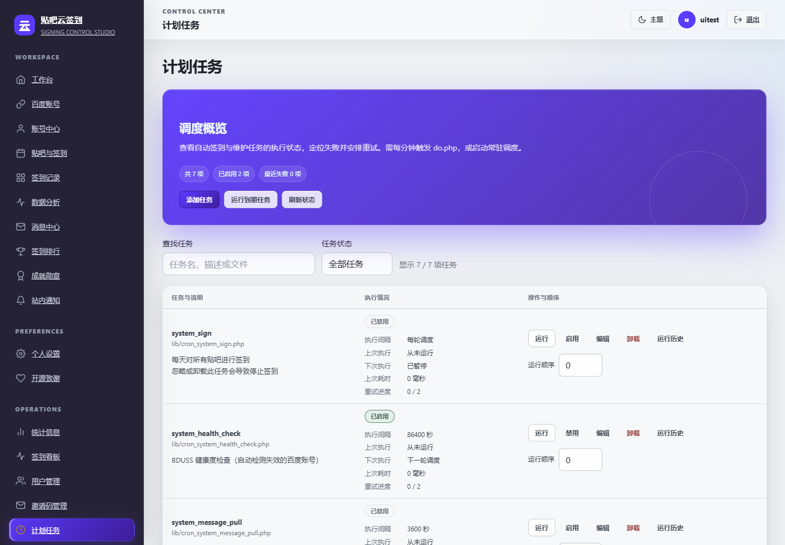
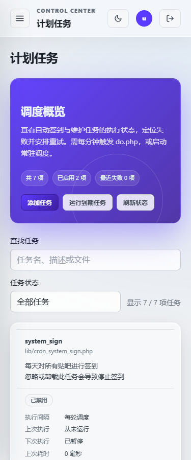

# 贴吧云签到自主升级交付报告 · 2026-11-13

> 本报告记录 7.5.0 基线下的开发与验收阶段，文中“未发布”是该阶段的状态。后续成果已纳入 7.6.0 发布准备；实际发布状态以 [GitHub Release](https://github.com/yuchen0x1/baidu-tieba-yunqiandao/releases/tag/v7.6.0) 为准。

## 交付结论与边界

基线：当前目录 `main` 分支，提交 `a7f404c`，版本 7.5.0，开始时工作区干净。完成了一轮调度可靠性、配置消费、备份恢复和任务运维升级；当前为**本地未发布改动**。没有提交、推送、发布、运行线上迁移或恢复用户业务数据库。

沿用 PHP/MySQL、插件协议和现有双主题，不新增业务依赖、数据表、迁移或对外 API 字段。版本号仍为 7.5.0，CHANGELOG 使用“未发布”条目。管理员任务 GET 写链接改为 POST + CSRF 表单，这项兼容变化需注意。

本轮执行 application-development、frontend-design、webapp-testing 工作流；检查项目、审计重点链路、研究 5 个开源项目、实现、数据库与浏览器验收、文档和截图均已完成。这里的完成指本轮可审查增量，不能解读为所有插件和外部服务均已通过生产验收。

## 1. 项目分析与功能地图

这是可自托管的 PHP Web 签到与账号管理系统，使用 MySQL/MariaDB、MySQLi、jQuery、Bootstrap 和自有 UI 组件。部署方式包括 Docker、传统 PHP 和 Windows 启动包；无前端编译链，并非独立原生 Windows App。

| 模块/主要入口 | 已有实现与本轮核查 | 本轮处理 |
| --- | --- | --- |
| `index.php`、`templates/control.php`、`lib/globals.php` | 路由、角色、用户登录、页面入口 | 沿用导航和角色体系 |
| `lib/class.misc.php`、`class.SignManager.php`、签到任务 | 多账号、多方式签到、复签、健康检查、行级 claim、历史与成长数据 | 修复全局代理密码读取 |
| `do.php`、`lib/class.cron.php` | Web/CLI/常驻调度、运行锁、重试、历史 | 本轮核心升级范围 |
| `class.SecretBox.php`、`class.P.php`、`class.option.php` | AES-GCM 配置加密、掩码、旧明文兼容 | 修复 cron 与代理消费者遗漏；通知、OAuth 等已迁移的消费者不重复开发 |
| `setting.php`、`ajax.php`、`api.php` | 管理操作、CSRF、Bearer API 与权限合同 | 任务写操作收紧为 POST + 显式令牌，API 合同保留 |
| `class.notify.php`、`class.webhook.php` | 多渠道通知和外发地址防护 | 静态核查，没有向真实渠道发送消息 |
| `lib/plugins.php`、`plugins/` | 插件安装、页面与任务钩子 | 保留协议，没有逐项调用全部外部插件 |
| `class.updater.php`、`upgrade.php`、迁移器 | Release 下载校验、备份、迁移和回退相关代码 | 复用备份修复；不宣称在线更新端到端通过 |
| `dataBak()`、定时备份与工具箱 | 手动/定时/更新前和部分插件转储 | 显式声明 utf8mb4，验证恢复一致性 |
| `tests/`、`tools/`、CI 与部署脚本 | 单元、集成、发布门禁与打包配置 | 扩充回归、浏览器验收，修复隔离副本遍历和测试连接编码 |

项目已有大量功能，不宜换框架或盲目增加 AI/队列服务。主要实际缺口集中在“任务按配置执行、失败可定位、备份可恢复”的运维链路，而非功能入口数量。

## 2. 开源竞品研究

2026-11-13 联网读取 GitHub 仓库元数据、README、目录、核心源码和许可证。下表均为设计研究，没有复制或执行竞品代码。分支链接可能继续变化，观察摘要与源文件地址另见 [研究索引 JSON](evolution-2026-11-13-research.json)。

| 项目及关联性 | 实际阅读与核实的实践 | 许可/维护观察 | 应用到本项目 |
| --- | --- | --- | --- |
| [MoeNetwork/Tieba-Cloud-Sign](https://github.com/MoeNetwork/Tieba-Cloud-Sign)，直接同类/历史上游 | README、目录、[cron 类](https://github.com/MoeNetwork/Tieba-Cloud-Sign/blob/master/lib/class.cron.php)、[许可](https://github.com/MoeNetwork/Tieba-Cloud-Sign/blob/master/license.html)：PHP 文件任务、插件和管理方式 | 非归档，最后推送 2026-10-22；自定义最终用户协议，含署名限制，API 标为 NOASSERTION | 保留 PHP/插件协议，不移植旧 SQL 写法或许可不明确代码 |
| [qd-today/qd](https://github.com/qd-today/qd)，HTTP 自动签到/任务相邻领域 | README、目录、[worker.py](https://github.com/qd-today/qd/blob/master/worker.py)：失败次数、重试间隔、日志保留、批量推送 | [MIT](https://github.com/qd-today/qd/blob/master/LICENSE)，最后推送 2026-11-07 | 单任务重试预算真正生效，明确退避与耗尽行为；不引入 HAR 编辑器 |
| [whyour/qinglong](https://github.com/whyour/qinglong)，定时任务运维相邻领域 | README、[cron service](https://github.com/whyour/qinglong/blob/develop/back/services/cron.ts)、[任务页](https://github.com/whyour/qinglong/blob/develop/src/pages/crontab/index.tsx)：运行实例/状态转换、搜索、状态筛选和操作 | [Apache-2.0](https://github.com/whyour/qinglong/blob/develop/LICENSE)，最后推送 2026-11-09 | 搜索/状态筛选、明确运行反馈、原子领取与安全写入；不引入任意 shell 执行平台 |
| [jhuckaby/Cronicle](https://github.com/jhuckaby/Cronicle)，作业调度相邻领域 | README、[scheduler.js](https://github.com/jhuckaby/Cronicle/blob/master/lib/scheduler.js)：调度游标、启用判定、补跑/队列和并发协调 | [许可文件为 MIT](https://github.com/jhuckaby/Cronicle/blob/master/LICENSE.md)，API 标为 NOASSERTION；README 已引导迁移至 xyOps，作为历史设计参考 | 在自动领取时检查到期与启用状态；不引入分布式集群 |
| [healthchecks/healthchecks](https://github.com/healthchecks/healthchecks)，任务监测相邻领域 | README、[models.py](https://github.com/healthchecks/healthchecks/blob/master/hc/api/models.py)：开始/结束、持续时间、宽限窗口与失败状态 | [BSD-3-Clause](https://github.com/healthchecks/healthchecks/blob/master/LICENSE)，最后推送 2026-11-10 | 区分历史启动事件与当前运行状态，保存开始时间并支持历史检索 |

没有发生代码移植，因此本轮未新增第三方代码许可义务。历史上游自定义协议与当前仓库 AGPL 声明的沿革仍值得单独复核，不能据本次研究认定已经解决。

### 功能差距对比

| 维度 | 升级前实际情况 | 竞品实践与差距 | 本轮成果 |
| --- | --- | --- | --- |
| 核心功能 | 加密保存后 cron/代理部分读取密文；单任务重试保存但未采用 | 配置与执行结果应一致 | 补解密消费，按任务限制重试 |
| UI | 三列长表、长日志 alert，手机操作难找 | 状态分层、清晰操作与独立日志 | 桌面表格、手机纵向任务、原生日志展开 |
| 体验 | 仅最近 20 条历史，无检索；异常可能仍提示成功 | 搜索、筛选、分页与失败定位 | 任务搜索、6 类视图、任务/状态/时间筛选和分页 |
| 架构 | 到期判断和领取分离；首次日志不受 finally 保护 | 原子状态变化与完整生命周期清理 | 数据库领取时检查到期/启用，持锁区统一 finally |
| 自动化 | 最大重试读全局；“指数退避”实际为线性 | 独立重试预算、明确退避 | 0–20 次按任务生效，1/2/4…倍增长，单次最多一天 |
| 扩展 | 既有文件任务与插件丰富 | 保持协议、复用查询 | 新增可选参数和独立历史查询，保留旧调用默认语义 |

## 3. 升级优先级与实现结果

| 优先级/任务 | 价值与收益 | 难度/风险/影响 | 结果 |
| --- | --- | --- | --- |
| P0 加密配置消费遗漏 | 恢复正确明文 cron 密码认证与代理密码使用 | 低；复用 SecretBox，兼容历史明文 | 完成 |
| P0 备份字符集可移植性 | 避免不同导入编码导致中文/emoji 失真或字段超长 | 低；SQL 编码声明，无业务迁移 | 完成，15 表恢复比对 |
| P1 过时到期快照窗口 | 拒绝已推进到未来或已停用任务的自动领取 | 中；自动调度原子条件，手动语义保留 | 完成，真实 SQL 检查 |
| P1 重试与错误生命周期 | 配置可控，异常后可恢复，结果可信 | 中；第三次及以后等待由线性改指数 | 完成 |
| P1 管理写操作与反馈 | 避免 GET 触发变更和失败假报成功 | 中；旧 GET 写链接须改用表单 | 完成，浏览器拒绝请求后确认状态不变 |
| P2 检索与手机操作 | 减少逐行查找，操作可发现 | 中；新增查询参数，沿用主题 | 完成 |
| P2 UTF-8 日志与旧历史兼容 | 长日志不截坏中文，旧结束事件仍可按时间查 | 低；沿用 mbstring，不改旧数据 | 完成 |
| P2 测试副本与编码一致性 | 排除运行产物，避免递归复制和夹具乱码 | 低；仅剪枝根目录，保留插件嵌套资源 | 完成 |

### 关键实现与兼容效果

- `do.php`、`cron::arun()`、`misc::getProxy()` 使用 SecretBox 解密；不把配置改回明文，不把密码放回管理页 URL。
- `acquireLock(name, scheduled)` 在自动模式通过同一条 UPDATE 校验启用、到期与锁。旧 `runOnce(name)` 仍是主动运行；重试只有取得锁后才重置计数。
- 异常记录日志但返回 false；首次日志、任务执行和排程均在 finally 解锁范围内。结束记录保存开始时间；长消息按 UTF-8 字符边界截断。
- `runHistory()` 绑定筛选值，每页上限 100，越界页码收敛。旧 `started_at=0` 事件按结束时间检索，缺失开始时间明确显示。
- 原生表单带显式令牌，包含加载态、运行中禁用、卸载确认、空结果和失败反馈。状态是刷新时快照，没有伪装成实时监控。
- 一次性任务执行后删除、每轮任务等既有行为保留。人工运行可绕过到期/禁用状态，仍需取得锁；界面和 README 已说明。
- 无新增业务依赖、表或迁移。对外 API 不变；任务管理员 GET 写入口返回 405，第三次以后退避时长变化需留意。

## 4. 重要文件修改清单

| 文件 | 原因 |
| --- | --- |
| `do.php`、`lib/class.misc.php` | 修复加密配置消费 |
| `lib/class.cron.php` | 原子领取、重试、解锁、错误返回、UTF-8 日志、历史查询 |
| `setting.php` | POST 门禁、令牌校验、持锁重试和失败跳转，包括签到看板调用方 |
| `templates/admin-cron.php` | 搜索、筛选、历史、表单与手机布局 |
| `source/css/cron.css`、`source/js/cron.js`（新增） | 独立样式和真实筛选/排序/操作反馈 |
| `lib/sfc.functions.php` | 通用 SQL 转储声明 utf8mb4 |
| `tests/CronSchedulerTest.php`、新增 `CronHistoryTest.php`、`SecretConsumersTest.php` | 窗口条件、重试、清理、参数绑定、UTF-8 和代理解密回归 |
| 新增 `tests/browser/cron-smoke.cjs` | 本地专用站点真实浏览器验收 |
| `tools/scheduler-integration-test.php`、`backup-restore-drill.php` | 加密 cron 认证、原子条件、旧历史兼容、跨编码恢复 |
| `tools/lib-integration.php`、`tools/lint.php` | 测试连接 utf8mb4；排除根目录运行产物，保留嵌套插件资源 |
| `.gitignore`、`.dockerignore` | 测试环境不入库/镜像 |
| `README.md`、`CHANGELOG.md`、本报告与研究 JSON | 同步能力、兼容变化和验证边界 |
| `docs/screenshots/cron-*.png`（新增） | 实际桌面、手机、平板及深色截图 |

没有删除用户文件、改写既有配置或恢复业务数据库。截图里的探针与分页记录是隔离测试夹具，不是真实百度签到结果。

## 5. 实测结果与未验证范围

环境：PHP 8.3.36、独立 MariaDB 11.4.9、Edge 无头浏览器。独立站点与运行产物位于被忽略的 `.evolution/runtime/`，数据库名以 `tcs_it_` 开头。基线 169 项单元测试有 3 个 OpenSSL 密钥测试跳过；补齐测试进程 OpenSSL 配置后，最终单元测试无跳过。

| 检查 | 命令/范围 | 结果 |
| --- | --- | --- |
| 单元测试 | 门禁调用 `php vendor/bin/phpunit` | PASS：178 项，0 失败/跳过 |
| PHP 语法/规则 | `php tools/lint.php` | PASS：232 文件；存量 addslashes/命令执行警告保留，不等同全站安全认证 |
| 凭据扫描 | `php tools/secret-scan.php` | PASS：规则范围内未发现泄露 |
| 迁移集成 | `php tools/migrate-integration-test.php` | PASS：46 项 |
| 调度集成 | `php tools/scheduler-integration-test.php` | PASS：61 项 |
| API 集成 | `php tools/api-integration-test.php` | PASS：20 项 |
| 备份恢复 | `php tools/backup-restore-drill.php` | PASS：15 项，15 表逐行一致；latin1 导入连接、中文/emoji/序列化配置 |
| 浏览器 | `node tests/browser/cron-smoke.cjs`，专用本地测试站点 | PASS：19 项，真实登录/POST/保存读回/历史分页/CSRF/GET 拒绝/375与768px/深色/无脚本异常 |
| JS 语法 | `node --check source/js/cron.js` | PASS |
| Composer | `validate --strict`、`check-platform-reqs`、`audit --locked --no-interaction` | PASS：配置/依赖满足，未发现已知漏洞公告 |
| 发布门禁 | `php tools/release-gate.php` | PASS：10 项通过，0 跳过/失败 |
| 格式 | `git diff --check` | PASS |
| 编译构建 | PHP 源码直接运行，无前端编译链 | NOT APPLICABLE；Docker 构建另列受阻 |
| Docker/多 PHP 版本 | Docker 引擎未启动，本机仅测试 PHP 8.3 | BLOCKED：未验证容器构建及 PHP 8.2/8.4 矩阵，不引用旧 CI 为本轮结果 |
| 百度/通知/更新/生产 | 没有本轮生产验收实例或真实账号链路 | PARTIAL：本地实现与集成通过，真实百度签到/失效通知/外部代理认证/旧版在线更新及长期运行未验收 |

数据库集成合计 142 项。自动领取的测试覆盖真实 SQL 下的已排程、锁冲突、过期锁和停用条件，不等于生产高并发压测。无前端编译步骤；全新 SQL 模板导入和独立站点启动已验证，未重下 Composer 全量依赖或安装 Windows 发布包。

首次备份演练 FAIL：Windows 测试连接默认 latin1，回放时字段超长。统一测试连接并让导出显式声明 utf8mb4 后，以 latin1 导入重跑通过，保留该边界回归。内置浏览器因运行组件缺失无法启动，Python Playwright 安装遇到 TLS/源访问失败；最终在项目内安装 npm Playwright，使用现有 Edge 完成替代验收。没有修改系统 PHP 配置或安装数据库系统服务。

测试变量：`PHP_INI_SCAN_DIR` 指向项目内 mysqli/sys_temp_dir 配置，`OPENSSL_CONF` 指向项目内临时配置，`TCS_IT_DB_HOST/PORT/USER/PASS` 指向独立实例（本轮端口 33319）。浏览器脚本变量及探针前提见文件注释，仅允许本地专用站点。运行日志在 `.evolution/runtime/` 的 `gate.log`、`browser.log`、`scheduler.log`、`migrations.log`、`api.log`、`backup.log`；以最终门禁记录为准。

### 实际界面（隔离测试数据）

[平板截图](../screenshots/cron-tablet.png) · [深色截图](../screenshots/cron-dark.png)

## 6. 后续优先级与剩余限制

- **P1 租约所有权/续租**：保留 `running/running_at` + TTL 模型。超长任务可能被接管，旧进程回写与外部副作用仍需所有者令牌、续租和幂等键方案。超时应大于最长任务耗时，本轮不保证 exactly-once。
- **P1 生产验收与发布认证**：真实账号签到/复签、凭据失效通知、代理、签名 Release、旧版本更新/回退需要专用实例。SHA-256 本身不等于发布者认证。
- **P1 备份一致性/大库**：本轮验证编码和重放，没有新增跨表事务快照、流式导出或大库压测，内存和并发一致性仍需专题改进。
- **P2 历史规模治理**：评估组合索引与游标分页；目前仍有 COUNT/OFFSET，未做百万行负载测试，也没有自动清除用户历史。
- **P2 完整体验/安全矩阵**：补读屏、手机触屏排序、更多浏览器与插件/通知渠道验收；数字顺序输入提供键盘替代。继续审查存量转义提示、可信代理配置和其他模块 GET 写入口。
- **P3 协议与架构**：按实际维护需求推进类型化任务结果、统一权限合同和许可证沿革复核；不为本轮新增 AI 服务、微服务或消息队列。

## 7. 完成度评估

以下是本轮影响范围的证据评级，满分需生产/规模/长期证据，不是全站商业成熟度或安全认证。

| 维度 | 评级 | 依据与上限 |
| --- | --- | --- |
| 功能完整度 | 4/5 | 查询、真实写入、错误处理闭环通过；外部百度链路未验收 |
| UI/UX | 4/5 | 桌面/手机/平板、双主题、空/失败/加载状态；未做完整读屏和触屏矩阵 |
| 代码质量 | 4/5 | 参数绑定、生命周期清理、178 单元测试和门禁；历史大模块仍在 |
| 性能 | 2/5 | 分页与副本剪枝有明确收益；无负载/内存基准，不给高分 |
| 安全性 | 3/5 | POST/令牌、加密消费、权限回归和依赖审计；无独立渗透审计，TTL 与其他入口待审 |
| 稳定性 | 3/5 | 本地单元/数据库/API/恢复/浏览器通过；无长期生产及容器/多版本矩阵 |
| 可维护性 | 4/5 | 无新业务依赖/迁移，独立资源、测试与说明；保留架构债务 |
| 扩展性 | 3/5 | 插件和旧调用默认语义保留、历史查询可复用；未实施分布式编排 |

未以竞品能力、未执行测试或旧报告为当前项目加分。当前适合本地审查和发版准备，正式发布仍需用户授权及独立生产验收。
